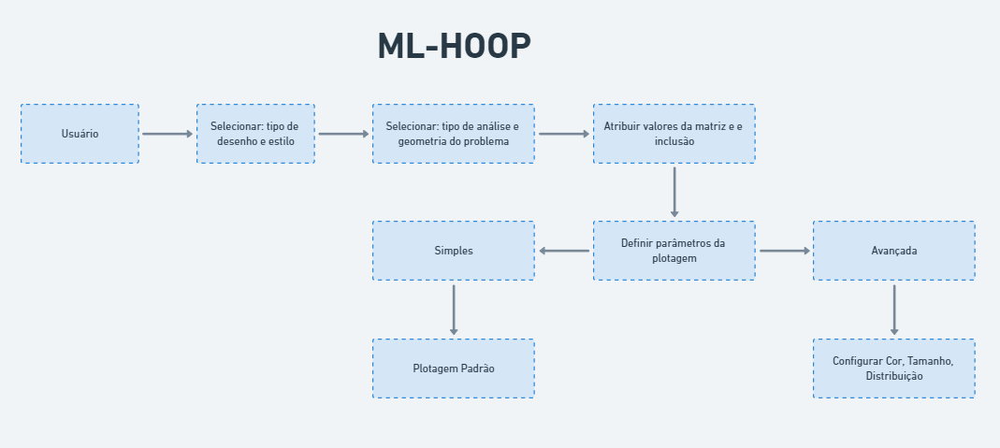

# Etapa-01

## Objetivo

Construir um software baseado no _framework_ proposto por Silva (2022) que permita aos usuário personalizar a saída da plotagem:
- Cores
- Legenda
- Quantidade de modelos
- Estatística dos modelos (e.g Distribuição)

## License

This project is licensed under the MIT License.